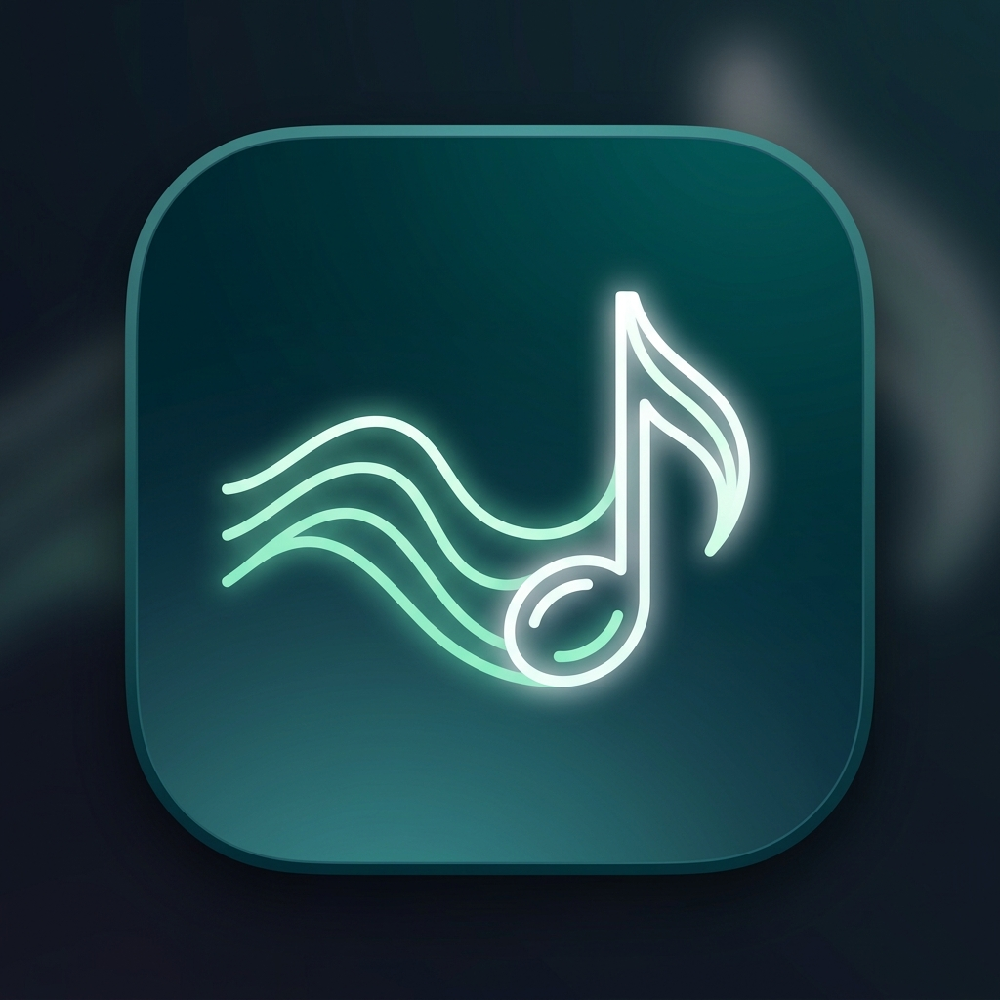

<p align="center">
  
</p>

# Sur

A lightweight, open-source Android music player for your local library.

> **Work in progress.** Usable day to day. Latest version: **v0.3.3**. Get it from [Releases](https://github.com/Sa-Alfy/Sur/releases).

## Install

1. Download `Sur-v0.3.3.apk` from the [latest release](https://github.com/Sa-Alfy/Sur/releases/latest) on your phone.
2. Open it and allow installing from this source when Android asks.
3. Launch Sur and allow access to your audio files.

Release APKs are signed with Sur's release key. SHA-256 certificate fingerprint:
`DA:D2:6A:E7:86:B2:52:6A:36:B6:81:F3:3F:F3:BE:1C:6C:76:1A:80:6C:EF:6C:0D:A3:6E:68:65:D7:75:6F:42`

## Features

- **Plays your local music**: scans the device library via MediaStore (skips ringtones, notification sounds and clips under 30 s).
- **Playlists first**: the home screen is your playlists with 2×2 cover mosaics. Create, rename, delete, drag to reorder, and add songs one at a time or by multi-select.
- **Background playback**: Media3 service with notification and lock screen controls, audio focus, and pause when headphones are unplugged.
- **Now playing**: art-tinted background gradient and controls via Palette, smooth crossfading, seek bar, shuffle, repeat (off / all / one), tap-to-jump queue view, and a persistent mini player.
- **Search**: songs by title, artist or album; playlists by name.
- **Material 3**: dynamic color on Android 12+, an accessible teal fallback palette on Android 8–11 with verified WCAG contrast, and it follows system light/dark.
- **Downloader**: save audio from a single YouTube link directly into your library (`Music/Sur`) via the Download tab or shared links, with live progress, song metadata, foreground notification controls, and audio tagging.
- **Playlists backup**: export playlists as M3U files and import them back — no extra permissions needed.
- **Find info**: look up track metadata (title, artist, album) and cover art via MusicBrainz and Cover Art Archive for songs one at a time, preview and edit queries before applying, with matches saved locally.
- **Light on resources**: built and tested on a 2 GB RAM Android 9 phone.
- **Private**: no accounts, cloud, ads or analytics. Network is used only for downloads you start and for Find info lookups you start (hosts: musicbrainz.org, coverartarchive.org and archive.org).

## Roadmap

- **Bitrate & format preferences**: options for audio quality and format in the downloader.
- **Batch / playlist queueing**: queue multiple downloads sequentially.

## Requirements

Android 8.0 (API 26) or newer.

Sur asks for:
- **Audio files**: to read your music library (`READ_MEDIA_AUDIO` on 13+, `READ_EXTERNAL_STORAGE` on 12 and below).
- **Notifications** (Android 13+, optional): to show playback controls and download progress.
- **Network access**: used only for downloads you start and for Find info lookups you start (hosts: musicbrainz.org, coverartarchive.org and archive.org).

Some phones (Oppo, Xiaomi, Vivo, Huawei…) stop background apps aggressively. If music cuts out, allow Sur to run without battery restrictions. Sur offers a shortcut on first launch.

## Tech

Kotlin, Jetpack Compose, Material 3, Media3 (ExoPlayer + MediaSessionService), Room, AndroidX Palette, and NewPipe Extractor + OkHttp for the downloader.
`minSdk` 26, `targetSdk` 37. Package: `io.github.saalfy.sur`.

## Build

Requires JDK 17 and the Android SDK (platform 37).

```bash
./gradlew assembleDebug
```

The debug APK is written to `app/build/outputs/apk/debug/`. Release builds (`./gradlew assembleRelease`) are minified, and are signed only when `SUR_RELEASE_STORE_FILE`, `SUR_RELEASE_STORE_PASSWORD`, `SUR_RELEASE_KEY_ALIAS` and `SUR_RELEASE_KEY_PASSWORD` are set as Gradle properties (e.g. in `~/.gradle/gradle.properties`). Otherwise they're unsigned. Run the unit tests with:

```bash
./gradlew testDebugUnitTest
```

Manual device test checklists live in [`docs/`](docs/).

## Disclaimer

Sur is intended for personal use to play your local music library. When using the downloader feature, you are solely responsible for ensuring you have the legal right or permission to download the audio content. Sur does not host or distribute any media and is not affiliated with or endorsed by YouTube or Google LLC.

## Developer

Made by **Shariar Ahamed** ([@Sa-Alfy](https://github.com/Sa-Alfy)). In the app, tap the ⓘ icon on the Playlists screen for About.

## License

Sur is free software, licensed under the [GNU General Public License v3.0](LICENSE) (GPL-3.0-only).

This program is distributed in the hope that it will be useful, but WITHOUT ANY WARRANTY; without even the implied warranty of MERCHANTABILITY or FITNESS FOR A PARTICULAR PURPOSE. See the [LICENSE](LICENSE) file for details.

Third-party libraries: AndroidX / Jetpack (Apache-2.0), [Reorderable](https://github.com/Calvin-LL/Reorderable) (Apache-2.0), [NewPipe Extractor](https://github.com/TeamNewPipe/NewPipeExtractor) (GPL-3.0), and [OkHttp](https://github.com/square/okhttp) (Apache-2.0).
